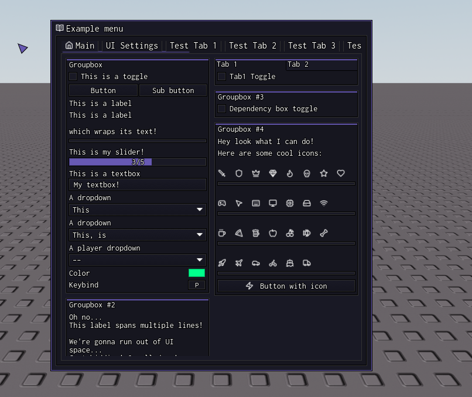

# Quorum UI Library
**Quorum UI is an improved fork of the [Linoria library](https://github.com/violin-suzutsuki/LinoriaLib/tree/main)**, rebuilt with a fresh aesthetic, Lucide icon support, and a completely reworked config system.

A modern, lightweight, and highly customizable UI library for Roblox UIs.

## Interface Preview


## Features
- **Icons Support:** Use any icon from [Lucide.dev](https://lucide.dev/) by wrapping the name in `<>` (e.g., `<home>`, `<sword>`).
- **Custom Cursor:** Built-in triangular cursor (can be toggled).
- **Themes & Saving:** Seamless integration with `QrmThemes` and `QrmSaveSettings`.
- **Responsive:** Adapts to mobile devices automatically.
- **Smooth Animations:** Fade-in/out effects and smooth dragging.

## Getting Started

Load the library using your tool's `loadstring`:

```luau
local repo = 'https://raw.githubusercontent.com/QuorumHub1/QuorumGUI-Library/main/'

local QuorumLib = loadstring(game:HttpGet(repo .. 'QrmLib.luau'))()
local ThemeManager = loadstring(game:HttpGet(repo .. 'QrmThemes.luau'))()
local SaveManager = loadstring(game:HttpGet(repo .. 'QrmSaveSettings.luau'))()
```

> **Note:** You can find a fully working example in the `Example.luau` file in this repository.

---

## API Reference

### Window Creation
```luau
local Window = QuorumLib:CreateWindow({
    Title = '<home>My Menu', -- Supports icons
    Center = true,            -- Centers the window on screen
    AutoShow = true,          -- Automatically opens the menu on load
    TabPadding = 8,           -- Padding between tabs
    MenuFadeTime = 0.2,       -- Fade animation time (seconds)
    Size = 'Default',         -- 'Small', 'Default', 'Big', or a UDim2
    UseCustomCursor = true,   -- Toggles the custom triangular cursor
    UseIcons = true           -- MUST be true to use Lucide icons
})
```

### Window Methods
Methods that can be called directly on the `Window` object.

#### SetSize
```luau
-- Valid presets: 'Small', 'Default', 'Big'
-- Or pass a number (pixels) or a UDim2 object
Window:SetSize('Big') 
Window:SetSize(UDim2.fromOffset(600, 500))
Window:SetSize(550)
```
*Note: When passing a number, the height is automatically calculated as `number * 1.1`.*

#### SetWindowTitle
```luau
Window:SetWindowTitle('<settings>New Title')
```

### Tabs
```luau
local Tab = Window:AddTab('<settings>Settings')
```

### Groupboxes
Groupboxes divide your tab into left and right columns. You can also create a Tabbox (a box with internal tabs).

```luau
-- Left side
local LeftGroup = Tab:AddLeftGroupbox('Main Settings')

-- Right side
local RightGroup = Tab:AddRightGroupbox('Extra Settings')

-- Tabbox (Left or Right)
local TabBox = Tab:AddRightTabbox('Misc')
local SubTab1 = TabBox:AddTab('Sub Tab 1')
```

### Elements

#### Toggle
```luau
LeftGroup:AddToggle('MyToggle', {
    Text = '<zap> Enable Feature',
    Default = true,
    Tooltip = 'This is a tooltip',
    Callback = function(Value)
        print('Toggle changed:', Value)
    end
})
```

#### Button
```luau
LeftGroup:AddButton({
    Text = 'Click Me',
    Func = function()
        print('Button clicked!')
    end,
    DoubleClick = false, -- Requires double click if true
    Tooltip = 'This is a tooltip'
})

-- Sub-button (appears next to the main button)
local MyButton = LeftGroup:AddButton({
    Text = 'Main Button',
    Func = function() end
})

MyButton:AddButton({
    Text = 'Sub Button',
    Func = function() end
})
```

#### Label
```luau
LeftGroup:AddLabel('This is a label')

-- With icon
LeftGroup:AddLabel('<sword> Equipped Weapon: Sword')

-- Wrapping text
LeftGroup:AddLabel('This is a very long label that will wrap to multiple lines!', true)
```

#### Divider
```luau
LeftGroup:AddDivider()
```

#### Slider
```luau
LeftGroup:AddSlider('MySlider', {
    Text = 'Walk Speed',
    Default = 16,
    Min = 16,
    Max = 100,
    Rounding = 0, -- 0 = integer, 1 = 1 decimal place, etc.
    Suffix = ' studs', -- Optional suffix
    Compact = false, -- If true, hides the label above
    Callback = function(Value)
        print('Slider changed:', Value)
    end
})
```

#### Input (Textbox)
```luau
LeftGroup:AddInput('MyInput', {
    Text = 'Enter Name',
    Default = '',
    Numeric = false, -- Only allows numbers if true
    Finished = false, -- Only fires callback when focus is lost
    Placeholder = 'Type here...',
    Callback = function(Value)
        print('Input changed:', Value)
    end
})
```

#### Dropdown
```luau
LeftGroup:AddDropdown('MyDropdown', {
    Values = { 'Option 1', 'Option 2', 'Option 3' },
    Default = 1, -- Index or Value
    Multi = false, -- Allow multiple selections
    Text = 'Select Option',
    Callback = function(Value)
        print('Dropdown changed:', Value)
    end
})

-- Player Dropdown
LeftGroup:AddDropdown('PlayerDropdown', {
    SpecialType = 'Player',
    Text = 'Select Player'
})
```

#### Color Picker
```luau
LeftGroup:AddLabel('Color'):AddColorPicker('MyColor', {
    Default = Color3.new(1, 0, 0),
    Title = 'Pick a Color',
    Transparency = 0, -- 0 to 1
    Callback = function(Value)
        print('Color changed:', Value)
    end
})
```

#### Key Picker (Keybind)
```luau
LeftGroup:AddLabel('Keybind'):AddKeyPicker('MyKeybind', {
    Default = 'E',
    SyncToggleState = false, -- If true, the keybind toggles a linked toggle
    Mode = 'Toggle', -- 'Always', 'Toggle', or 'Hold'
    Text = 'Interact',
    NoUI = false, -- If true, hides from the keybind list
    Callback = function(State)
        print('Keybind state:', State)
    end
})
```

#### Dependency Box
```luau
local Toggle = LeftGroup:AddToggle('EnableFeature', { Text = 'Enable Feature' })

local Depbox = LeftGroup:AddDependencyBox()
Depbox:AddSlider('DepSlider', { Text = 'Dependent Slider', Default = 50, Min = 0, Max = 100, Rounding = 0 })

Depbox:SetupDependencies({
    { Toggle, true } -- Only shows if 'EnableFeature' is true
})
```

---

## Library Methods

### Notifications
```luau
QuorumLib:Notify('Message', 5, 'TopLeft') 
-- Time (seconds), Position ('TopLeft', 'TopRight', 'BottomLeft', 'BottomRight')
```

### Watermark
```luau
QuorumLib:SetWatermarkVisibility(true)
QuorumLib:SetWatermark('Quorum | 60 FPS | 20ms')
```

### Menu Toggle & Keybinds
```luau
QuorumLib.ToggleKeybind = Options.MyKeybind -- Assign a keybind to open/close the menu
QuorumLib:SetKeybindVisibility(true) -- Show/hide the keybind list overlay
```

### Custom Cursor & Camera
```luau
QuorumLib:SetCustomCursor(true)
QuorumLib.UnlockCamera = true -- Unlocks camera from shift-lock when menu is open
```

### Keybind Visibility
Shows or hides the floating keybind list overlay on the left side of the screen.
```luau
QuorumLib:SetKeybindVisibility(true)  -- Show
QuorumLib:SetKeybindVisibility(false) -- Hide
```

### GetKeybindState
Checks if a specific keybind is currently active (useful for `Hold` mode).
```luau
-- Returns true if the keybind is currently held/toggled
local isHeld = Options.MyKeybind:GetState()
```

### Save Attempt
Forces the `SaveManager` to save the current configuration immediately (usually handled automatically by the library).
```luau
QuorumLib:AttemptSave()
```

### Unload
```luau
QuorumLib:Unload()
```

---

## Config & Saving (QrmSaveSettings)

The `SaveManager` allows you to save toggles, sliders, and inputs to a JSON file, so users don't have to reconfigure the script every time they execute it.

### Setup
```luau
local SaveManager = loadstring(game:HttpGet(repo .. 'QrmSaveSettings.luau'))()

-- Initialize the library
SaveManager:SetLibrary(QuorumLib)

-- Set the folder where configs will be saved.
-- It's highly recommended to use the game's PlaceId so configs don't mix between games.
SaveManager:SetFolder('QuorumHub/specific-game') 
```

### Building the Config UI
```luau
-- This automatically adds a "Config" section (with Save/Load/Delete buttons) to the specified tab.
SaveManager:BuildConfigSection(Tabs['UI Settings'])
```

### Autoload Config
```luau
-- Automatically loads the config file named "autoload.json" when the script runs (if it exists).
SaveManager:LoadAutoloadConfig()
```

### Ignoring Elements
If you have elements that shouldn't be saved (like a menu keybind or a theme selector), you can ignore them:

```luau
-- Ignore all settings related to the Theme Manager
SaveManager:IgnoreThemeSettings()

-- Ignore specific indexes by their option name (e.g., the keybind to open the menu)
SaveManager:SetIgnoreIndexes({ 'MenuKeybind' })
```

---

## Themes (QrmThemes)

Allows users to change the UI's color scheme.

```luau
local ThemeManager = loadstring(game:HttpGet(repo .. 'QrmThemes.luau'))()

ThemeManager:SetLibrary(QuorumLib)

-- Set folder for saving custom themes
ThemeManager:SetFolder('QuorumHub')

-- This adds a "Theme" section to the specified tab with a dropdown to select themes and a color picker to edit them.
ThemeManager:ApplyToTab(Tabs['UI Settings'])
```

---

## Icons (Lucide)
To use an icon, simply wrap its name in `<>` (e.g., `<sword>`).
- **Format:** `<icon-name>`
- **Icon List:** Search for icon names at [Lucide.dev](https://lucide.dev/).
- **Important:** You must set `UseIcons = true` in `CreateWindow` for icons to load.

---

## Mobile Support
The library automatically detects mobile devices and scales the window, adding a toggle button in the bottom right corner.

---

# Usage Example (`Example.luau`)

```luau
local repo = 'https://raw.githubusercontent.com/QuorumHub1/QuorumGUI-Library/main/'

local QuorumLib = loadstring(game:HttpGet(repo .. 'QrmLib.luau'))()
local ThemeManager = loadstring(game:HttpGet(repo .. 'QrmThemes.luau'))()
local SaveManager = loadstring(game:HttpGet(repo .. 'QrmSaveSettings.luau'))()

QuorumLib:Notify('Loaded')

local Window = QuorumLib:CreateWindow({
    Title = '<book-open-text>Example menu',
    Center = true,
    AutoShow = true,
    TabPadding = 8,
    MenuFadeTime = 0.2,
    Size = 'Default', -- Valid options: 'Small', 'Default', 'Big' or UDim2
    UseCustomCursor = true,
    UseIcons = true -- Use Lucide.dev to get icons ID
})

-- Window:SetSize('Small') -- Uncomment to test

local Tabs = {
    Main = Window:AddTab('<home>Main'),
    ['UI Settings'] = Window:AddTab('UI Settings'),
}

for i = 1, 10 do
    Tabs['Test Tab ' .. i] = Window:AddTab('Test Tab ' .. i)
end

local LeftGroupBox = Tabs.Main:AddLeftGroupbox('Groupbox')

LeftGroupBox:AddToggle('MyToggle', {
    Text = 'This is a toggle',
    Default = true,
    Tooltip = 'This is a tooltip',

    Callback = function(Value)
        print('[cb] MyToggle changed to:', Value)
    end
})

Toggles.MyToggle:OnChanged(function()
    print('MyToggle changed to:', Toggles.MyToggle.Value)
end)

Toggles.MyToggle:SetValue(false)

local MyButton = LeftGroupBox:AddButton({
    Text = 'Button',
    Func = function()
        print('You clicked a button!')
    end,
    DoubleClick = false,
    Tooltip = 'This is the main button'
})

local MyButton2 = MyButton:AddButton({
    Text = 'Sub button',
    Func = function()
        print('You clicked a sub button!')
    end,
    DoubleClick = true,
    Tooltip = 'This is the sub button (double click me!)'
})

LeftGroupBox:AddLabel('This is a label')
LeftGroupBox:AddLabel('This is a label\n\nwhich wraps its text!', true)
LeftGroupBox:AddDivider()

LeftGroupBox:AddSlider('MySlider', {
    Text = 'This is my slider!',
    Default = 0,
    Min = 0,
    Max = 5,
    Rounding = 1,
    Compact = false,

    Callback = function(Value)
        print('[cb] MySlider was changed! New value:', Value)
    end
})

local Number = Options.MySlider.Value
Options.MySlider:OnChanged(function()
    print('MySlider was changed! New value:', Options.MySlider.Value)
end)

Options.MySlider:SetValue(3)

LeftGroupBox:AddInput('MyTextbox', {
    Default = 'My textbox!',
    Numeric = false,
    Finished = false,

    Text = 'This is a textbox',
    Tooltip = 'This is a tooltip',

    Placeholder = 'Placeholder text',

    Callback = function(Value)
        print('[cb] Text updated. New text:', Value)
    end
})

Options.MyTextbox:OnChanged(function()
    print('Text updated. New text:', Options.MyTextbox.Value)
end)

LeftGroupBox:AddDropdown('MyDropdown', {
    Values = { 'This', 'is', 'a', 'dropdown' },
    Default = 1,
    Multi = false,

    Text = 'A dropdown',
    Tooltip = 'This is a tooltip',

    Callback = function(Value)
        print('[cb] Dropdown got changed. New value:', Value)
    end
})

Options.MyDropdown:OnChanged(function()
    print('Dropdown got changed. New value:', Options.MyDropdown.Value)
end)

Options.MyDropdown:SetValue('This')

LeftGroupBox:AddDropdown('MyMultiDropdown', {
    Values = { 'This', 'is', 'a', 'dropdown' },
    Default = 1,
    Multi = true,

    Text = 'A dropdown',
    Tooltip = 'This is a tooltip',

    Callback = function(Value)
        print('[cb] Multi dropdown got changed:', Value)
    end
})

Options.MyMultiDropdown:OnChanged(function()
    print('Multi dropdown got changed:')
    for key, value in next, Options.MyMultiDropdown.Value do
        print(key, value)
    end
end)

Options.MyMultiDropdown:SetValue({
    This = true,
    is = true,
})

LeftGroupBox:AddDropdown('MyPlayerDropdown', {
    SpecialType = 'Player',
    Text = 'A player dropdown',
    Tooltip = 'This is a tooltip',

    Callback = function(Value)
        print('[cb] Player dropdown got changed:', Value)
    end
})

LeftGroupBox:AddLabel('Color'):AddColorPicker('ColorPicker', {
    Default = Color3.new(0, 1, 0),
    Title = 'Some color',
    Transparency = 0,

    Callback = function(Value)
        print('[cb] Color changed!', Value)
    end
})

Options.ColorPicker:OnChanged(function()
    print('Color changed!', Options.ColorPicker.Value)
    print('Transparency changed!', Options.ColorPicker.Transparency)
end)

Options.ColorPicker:SetValueRGB(Color3.fromRGB(0, 255, 140))

LeftGroupBox:AddLabel('Keybind'):AddKeyPicker('KeyPicker', {
    Default = 'P',
    SyncToggleState = false,
    Mode = 'Toggle',
    Text = 'Auto lockpick safes',
    NoUI = false,

    Callback = function(Value)
        print('[cb] Keybind clicked!', Value)
    end,

    ChangedCallback = function(New)
        print('[cb] Keybind changed!', New)
    end
})

Options.KeyPicker:OnClick(function()
    print('Keybind clicked!', Options.KeyPicker:GetState())
end)

Options.KeyPicker:OnChanged(function()
    print('Keybind changed!', Options.KeyPicker.Value)
end)

task.spawn(function()
    while true do
        wait(1)
        local state = Options.KeyPicker:GetState()
        if state then
            print('KeyPicker is being held down')
        end
        if QuorumLib.Unloaded then break end
    end
end)

Options.KeyPicker:SetValue({ 'P', 'Toggle' })

local LeftGroupBox2 = Tabs.Main:AddLeftGroupbox('Groupbox #2');
LeftGroupBox2:AddLabel('Oh no...\nThis label spans multiple lines!\n\nWe\'re gonna run out of UI space...\nJust kidding! Scroll down!\n\n\nHello from below!', true)

local TabBox = Tabs.Main:AddRightTabbox()

local Tab1 = TabBox:AddTab('Tab 1')
Tab1:AddToggle('Tab1Toggle', { Text = 'Tab1 Toggle' });

local Tab2 = TabBox:AddTab('Tab 2')
Tab2:AddToggle('Tab2Toggle', { Text = 'Tab2 Toggle' });

local RightGroupbox = Tabs.Main:AddRightGroupbox('Groupbox #3');
RightGroupbox:AddToggle('ControlToggle', { Text = 'Dependency box toggle' });

local Depbox = RightGroupbox:AddDependencyBox();
Depbox:AddToggle('DepboxToggle', { Text = 'Sub-dependency box toggle' });

local SubDepbox = Depbox:AddDependencyBox();
SubDepbox:AddSlider('DepboxSlider', { Text = 'Slider', Default = 50, Min = 0, Max = 100, Rounding = 0 });
SubDepbox:AddDropdown('DepboxDropdown', { Text = 'Dropdown', Default = 1, Values = {'a', 'b', 'c'} });

Depbox:SetupDependencies({
    { Toggles.ControlToggle, true }
});

SubDepbox:SetupDependencies({
    { Toggles.DepboxToggle, true }
});

-- NEW: Groupbox #4 (Right Side)
local IconGroup = Tabs.Main:AddRightGroupbox('Groupbox #4')
IconGroup:AddLabel('Hey look what I can do!')
IconGroup:AddLabel('Here are some cool icons:')
-- Use Lucide.dev to get icons ID
IconGroup:AddLabel('<sword> <shield> <crown> <gem> <flame> <skull> <star> <heart>')
IconGroup:AddDivider()
IconGroup:AddLabel('<gamepad-2> <mouse-pointer-2> <keyboard> <monitor> <cpu> <hard-drive> <wifi>')
IconGroup:AddDivider()
IconGroup:AddLabel('<coffee> <pizza> <beer> <apple> <cherry> <fish> <bone>')
IconGroup:AddDivider()
IconGroup:AddLabel('<rocket> <plane> <car> <bike> <ship> <truck>')
IconGroup:AddDivider()
IconGroup:AddButton({
    Text = '<zap> Button with icon',
    Func = function() print('Icon button clicked') end
})

-- Notification Example (moved from UI settings to Main)
local NotificationGroup = Tabs.Main:AddLeftGroupbox('Notifications')
NotificationGroup:AddButton('Send Notifications', function()
    task.spawn(function()
        QuorumLib:Notify('Left Top', 2, 'TopLeft')
        task.wait(1)
        QuorumLib:Notify('Right Top', 2, 'TopRight')
        task.wait(1)
        QuorumLib:Notify('Left Bottom', 2, 'BottomLeft')
        task.wait(1)
        QuorumLib:Notify('Right Bottom', 2, 'BottomRight')
    end)
end)

-- Library functions
QuorumLib:SetWatermarkVisibility(true)

local FrameTimer = tick()
local FrameCounter = 0;
local FPS = 60;

local WatermarkConnection = game:GetService('RunService').RenderStepped:Connect(function()
    FrameCounter += 1;

    if (tick() - FrameTimer) >= 1 then
        FPS = FrameCounter;
        FrameTimer = tick();
        FrameCounter = 0;
    end;

    QuorumLib:SetWatermark(('Quorum UI Library demo | %s fps | %s ms'):format(
        math.floor(FPS),
        math.floor(game:GetService('Stats').Network.ServerStatsItem['Data Ping']:GetValue())
    ));
end);

QuorumLib:OnUnload(function()
    WatermarkConnection:Disconnect()
    print('Unloaded!')
    QuorumLib.Unloaded = true
end)

-- UI Settings
local MenuGroup = Tabs['UI Settings']:AddLeftGroupbox('Menu')

MenuGroup:AddButton('Unload', function() QuorumLib:Unload() end)
MenuGroup:AddLabel('Menu bind'):AddKeyPicker('MenuKeybind', { Default = 'End', NoUI = true, Text = 'Menu keybind' })

QuorumLib.ToggleKeybind = Options.MenuKeybind

MenuGroup:AddDivider()

MenuGroup:AddToggle('ShowKeybinds', {
    Text = 'Show Keybinds Menu',
    Default = true,
    Tooltip = 'Shows or hides the keybind list on the left side of the screen',
    Callback = function(Value)
        QuorumLib:SetKeybindVisibility(Value)
    end
})

MenuGroup:AddToggle('CustomCursor', {
    Text = 'Use Custom Cursor',
    Default = true,
    Tooltip = 'Toggle the fancy triangular cursor',
    Callback = function(Value)
        QuorumLib:SetCustomCursor(Value)
    end
})

MenuGroup:AddToggle('CameraLock', {
    Text = 'Camera Lock',
    Default = true,
    Tooltip = 'Unlocks the mouse from the center of the screen when in first-person or shift-lock',
    Callback = function(Value)
        QuorumLib.UnlockCamera = Value
    end
})

-- Window Size Block
local SizeGroup = Tabs['UI Settings']:AddRightGroupbox('Window Size')

SizeGroup:AddDropdown('SizePreset', {
    Text = 'Preset Size',
    Values = { 'Small', 'Default', 'Big' },
    Default = 'Default',
    Callback = function(Value)
        Window:SetSize(Value)
    end
})

SizeGroup:AddSlider('CustomSize', {
    Text = 'Custom Size (px)',
    Default = 550,
    Min = 300,
    Max = 1000,
    Rounding = 0,
    Callback = function(Value)
        Window:SetSize(Value)
    end
})

-- Addons:
ThemeManager:SetLibrary(QuorumLib)
SaveManager:SetLibrary(QuorumLib)

SaveManager:IgnoreThemeSettings()
SaveManager:SetIgnoreIndexes({ 'MenuKeybind' })

ThemeManager:SetFolder('QuorumHub')
SaveManager:SetFolder('QuorumHub/specific-game')

SaveManager:BuildConfigSection(Tabs['UI Settings'])
ThemeManager:ApplyToTab(Tabs['UI Settings'])

SaveManager:LoadAutoloadConfig()
```
